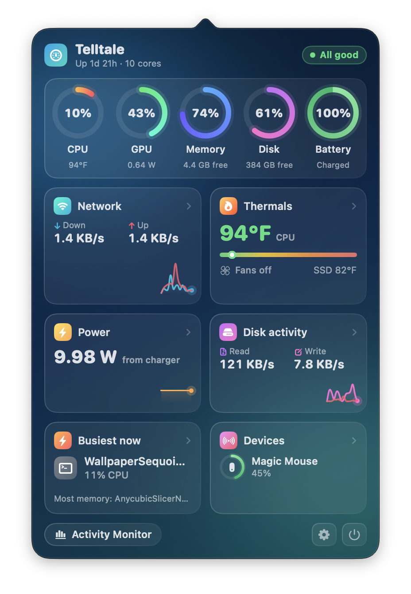
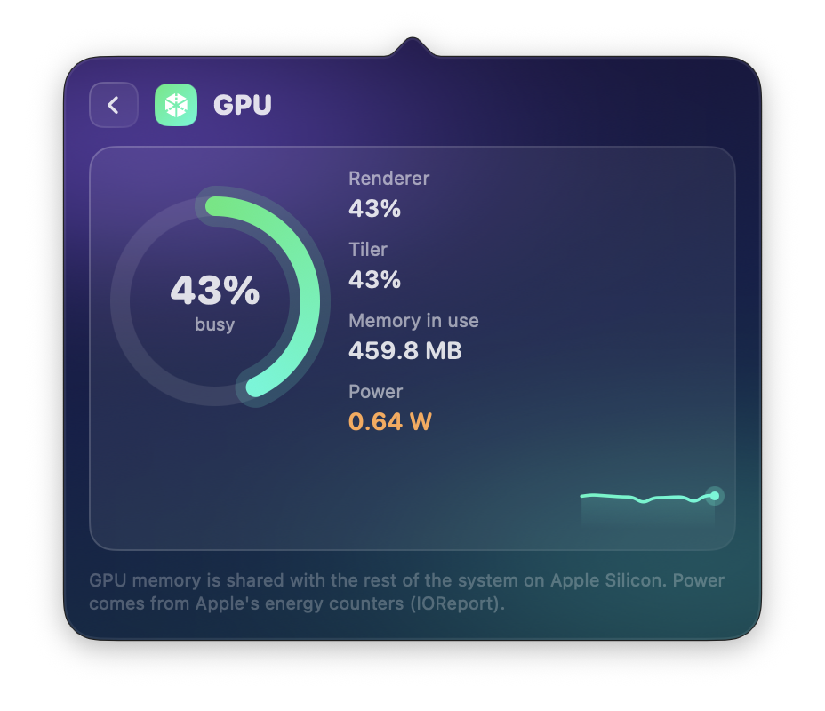
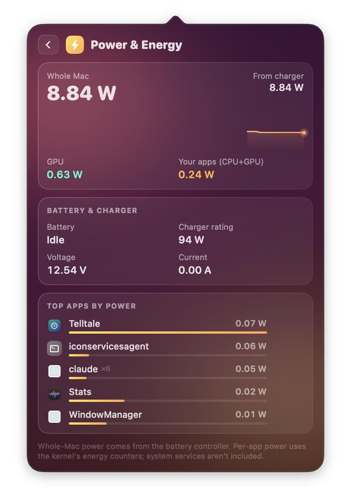
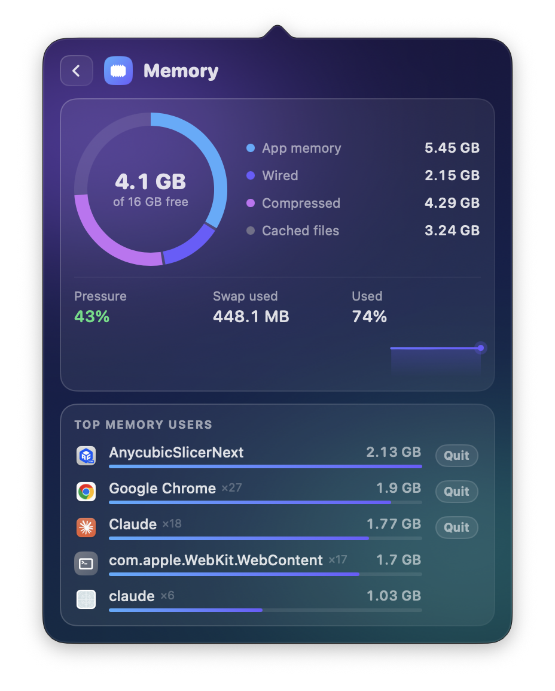
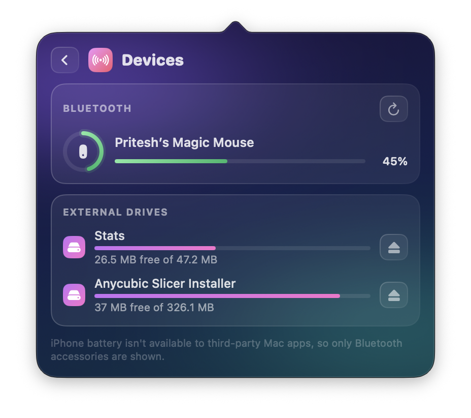

<div align="center">


# Telltale

**A beautiful, featherweight system monitor for your Mac's menu bar.**

CPU, GPU, memory, disk, power, battery, network, Bluetooth devices, temperatures and fans — one click away,
in a panel that idles at **~13 MB of memory and ~0% CPU**.

[](https://github.com/pri-te-sh/Telltale/actions/workflows/build.yml)
[](https://github.com/pri-te-sh/Telltale/releases/latest)


[](LICENSE)

[**Download**](https://github.com/pri-te-sh/Telltale/releases/latest) ·
[**Website**](https://pri-te-sh.github.io/Telltale/) ·
[Features](#features) · [Install](#install) · [Cost](#what-it-costs-to-run) · [FAQ](#faq) · [Contributing](#contributing)


</div>

---

> On a car dashboard, *telltales* are the little lights that tell you at a glance when something
> needs attention. Telltale does the same for your Mac.

## Why Telltale?

Most menu-bar monitors either look like spreadsheets or quietly cost a steady trickle of memory and CPU.
Telltale is built to be both **pleasant to look at** and **almost free to run** — and to cover the
things you'd otherwise open Activity Monitor for.

- **Everything in one panel:** per-core CPU, GPU, memory, disk space and activity, whole-Mac power,
  battery health, network, Bluetooth batteries, temperatures and fans.
- **Live readouts in the menu bar** with mini charts — pick any of eight, or keep just an icon.
- **Alerts** when the CPU runs hot, memory gets tight, disk space or battery runs low.
- **You only pay for what you show.** Every extra is opt-in; with just the icon, Telltale idles at ~13 MB and ~0% CPU.
- **No helpers, no daemons, no dependencies, no network access** (except the speed test you start).

## Features

<table>
<tr>
<td width="50%" valign="top">

**At a glance**
- Gauges for **CPU**, **GPU**, **memory**, **disk** and **battery**
- **Health pill**: *All good*, *Working hard*, *Memory tight*, *Battery low*, *Disk nearly full*, *Running hot*
- **Power**, **disk activity**, network and thermals cards
- **Busiest app** right now and the app using the most memory

</td>
<td width="50%" valign="top">

**Menu bar**
- Up to eight live readouts: CPU, GPU, memory, disk activity, network, CPU temperature, power draw, battery
- Optional **mini charts**
- Update every **1, 2, 3 or 5 seconds**
- Drawn as one template image, so it adapts to light and dark menu bars

</td>
</tr>
<tr>
<td valign="top">

**CPU, GPU & memory**
- Load history, user / system / idle, load average
- **Per-core load**, split into **performance** and **efficiency** cores
- **GPU** utilization (renderer, tiler), GPU memory in use and **GPU power**
- App / wired / compressed / cached memory, **pressure** and **swap**
- **Top apps** by CPU and memory, helpers grouped under their app, one-click **Quit**

</td>
<td valign="top">

**Power, disk & thermals**
- **Whole-Mac power draw**, charger input, battery charge/discharge watts, voltage and current
- **Top apps by power** (watts, from the kernel's energy counters)
- **Disk read/write speed** and **top apps by disk activity**
- Hottest and average **CPU core**, **SoC**, **SSD** and **battery** temperatures, all raw sensors
- **Fan speeds** with min/max range

</td>
</tr>
<tr>
<td valign="top">

**Battery, network & devices**
- Charge, time remaining, **cycle count**, **health vs. design capacity**, charger wattage
- Wi-Fi signal, link speed, security, IP, live up/down graphs, totals since startup
- **Speed test** with Apple's built-in `networkQuality`
- **Bluetooth accessory batteries** (Magic Mouse, Keyboard, Trackpad, AirPods…)
- **External drives** with free space and one-click eject

</td>
<td valign="top">

**Alerts & personalization**
- Notifications for **CPU temperature**, **memory pressure**, **low disk space** and **low battery**, each with its own threshold
- Themes: **Aurora**, **Sunset**, **Ocean**, **Graphite**, **System** (follows light/dark mode)
- °F / °C, open at login

</td>
</tr>
</table>

<p align="center">
  
</p>

<p align="center">
  
  
  
</p>

<details>
<summary><b>More screenshots</b></summary>
<br>
<p align="center">
  
  
  
  
  
  
  
  
  
</p>
</details>

## What it costs to run

Measured with [`scripts/measure.sh`](scripts/measure.sh) on an M1 Pro MacBook Pro (macOS 27), 60 seconds per
configuration, next to [Stats](https://github.com/exelban/stats) 3.1.1 running with its default five menu-bar
readouts. Memory is `phys_footprint` (what Activity Monitor shows); CPU is % of one core.

| Telltale configuration | Telltale | Stats (defaults, same window) |
|---|---|---|
| Panel closed · icon only | **13 MB · 0.03%** | 73 MB · 4.9% |
| Panel closed · 6 readouts + charts · every 3 s | **19 MB · 0.7%** | 73 MB · 5.0% |
| Panel closed · 6 readouts + charts · every 1 s | **19 MB · 2.4%** | 73 MB · 5.0% |
| Panel open · overview | **54 MB · 3.6%** | 73 MB · 5.3% |

The configurations aren't identical feature-for-feature, and numbers vary with what your Mac is doing —
run `./scripts/measure.sh --compare Stats` (or any app name) to measure on your own machine.

### Why it stays light

- **You only pay for what you show.** With the panel closed, Telltale reads CPU, memory and network
  counters on one shared timer; GPU, disk, power and temperature are read only if they're in the menu bar
  or an alert needs them. Temperature is refreshed at most every 3 seconds, from one sensor per core.
- **The panel only exists while it's open.** The whole SwiftUI view tree is created when you click the
  icon and released when it closes. GPU power metering is subscribed only while the panel is open.
- **Page-aware sampling.** The full 60-sensor sweep runs only on the Thermals page; the slow,
  purgeable-aware disk-space query runs every 30 seconds (every 5 on the Storage page).
- **No per-frame work.** Gauges sweep in once; live values then update in place instead of animating
  120× per second. Backdrops and app icons are drawn once and reused; the popover is resized only when
  its content's size changes.
- **One pass, no subprocesses.** Per-app CPU, memory, power and disk I/O come from a single `libproc`
  pass every 2 seconds. Only Bluetooth names (every 30 s while open) and the speed test spawn a process.

## Install

### Download (recommended)

1. Download **Telltale-x.y.z.zip** from the [latest release](https://github.com/pri-te-sh/Telltale/releases/latest).
2. Unzip it and drag **Telltale.app** to your **Applications** folder.
3. Open it — a gauge icon appears in your menu bar. Click it.

#### First launch

Telltale is open source and not (yet) notarized by Apple, so macOS will warn you the first time:

- **macOS 15 and later:** open Telltale once, then go to **System Settings → Privacy & Security**,
  scroll down and click **Open Anyway** next to the Telltale message.
- **macOS 14:** right-click **Telltale.app** → **Open** → **Open**.
- Or, from Terminal: `xattr -dr com.apple.quarantine /Applications/Telltale.app`

You only need to do this once. If you'd rather not trust a downloaded binary, [build it yourself](#build-from-source) — it takes about a minute.

### Build from source

Requirements: macOS 14 or later and Xcode (or the Xcode Command Line Tools: `xcode-select --install`).

```bash
git clone https://github.com/pri-te-sh/Telltale.git
cd Telltale
./build.sh --install
```

| Command | What it does |
|---|---|
| `./build.sh` | Build for this Mac → `build/Telltale.app` |
| `./build.sh --universal` | Build for Apple Silicon **and** Intel |
| `./build.sh --install` | Build, copy to `~/Applications` and launch |
| `./build.sh --zip` | Universal build packaged as `build/Telltale-<version>.zip` |

There is no Xcode project, package manager or third-party dependency — `build.sh` calls `swiftc` directly.

## Using Telltale

- **Click the menu bar icon** to open the panel. Click a gauge or card for details; **‹** goes back.
- **Settings** (⚙ at the bottom): theme, open at login, °F / °C, **menu bar readouts** (tick any of eight,
  plus mini charts), **update interval** and **alerts**.
- **Alerts:** turn on any of CPU temperature, memory pressure, low disk space and low battery, and drag its
  threshold. An alert fires after the condition holds for two checks in a row, then stays quiet for 10–30 minutes.
- **Wi-Fi name:** macOS only reveals network names to apps with Location access. Click
  **Show name** on the Network page if you want it; Telltale never reads your location.

## Privacy & permissions

Telltale collects nothing and sends nothing. It has no analytics, no crash reporter and no update checker.

| Permission | When it's asked | Why |
|---|---|---|
| Location | Only if you click **Show name** | macOS hides Wi-Fi network names from apps without it |
| Notifications | Only if you turn on an **alert** | To show the alert |
| Login items | Only if you turn on **Open at login** | To start with your Mac |

The only network traffic Telltale ever creates is Apple's `networkQuality` test, and only when you press **Run test**.

## How it works

Telltale reads everything directly from macOS — no kernel extensions, no root helper, no scraping of other tools.

| Data | Source |
|---|---|
| CPU load | `host_statistics` (`HOST_CPU_LOAD_INFO`) |
| Per-core load, P/E cores | `host_processor_info` + `hw.perflevel0/1.logicalcpu` |
| GPU utilization & memory | IOKit `IOAccelerator` → `PerformanceStatistics` |
| GPU power | IOReport "Energy Model" counters (no root needed) |
| Memory, pressure, swap | `host_statistics64` (`HOST_VM_INFO64`), `kern.memorystatus_level`, `vm.swapusage` |
| Per-app CPU, memory, power, disk I/O | `libproc` (`proc_pid_rusage` v6: CPU time, `ri_phys_footprint`, `ri_energy_nj`, disk bytes) |
| Disk space | `URLResourceValues` (`volumeAvailableCapacityForImportantUsage` = Finder's "available") |
| Disk activity | IOKit `IOBlockStorageDriver` → `Statistics` |
| Whole-Mac power, battery watts | `AppleSmartBattery` → `PowerTelemetryData`, voltage × amperage |
| Network throughput | `sysctl` ifmib 64-bit interface counters (same as `netstat`) |
| Wi-Fi | CoreWLAN |
| Battery | IOKit power sources + `AppleSmartBattery` (cycles, capacity, adapter) |
| Temperatures | IOHID temperature sensors (Apple Silicon PMU, SSD, battery gas gauge) |
| Fans | SMC keys `FNum`, `F#Ac`, `F#Mn`, `F#Mx` (read-only) |
| Bluetooth batteries | `system_profiler SPBluetoothDataType` + IOKit HID `BatteryPercent` |
| Speed test | `/usr/bin/networkQuality -c` |

## FAQ

**Can Telltale control fan speeds?**
Not today. Reading fans is safe and needs no special rights; *setting* them requires a privileged
root helper and can overheat a Mac if done wrong. It's planned as an opt-in.

**Why don't I see CPU or Neural Engine watts, only GPU and whole-Mac power?**
On current macOS versions the CPU and ANE energy counters read zero for apps without root. Telltale shows
whole-Mac power from the battery controller, GPU power from IOReport, and per-app power (which covers CPU
time) from the kernel's energy counters.

**Why isn't my iPhone's battery shown?**
macOS doesn't expose iPhone battery levels to third-party apps. Bluetooth accessories are supported.

**Does it work on Intel Macs?**
Release builds are universal. CPU, memory, disk, battery, network and devices work everywhere;
temperatures, GPU power and P/E core split use Apple Silicon features, so some readings may show "—".
Intel reports are welcome.

**Why not the Mac App Store?**
App Store apps are sandboxed and can't read thermal sensors, fan speeds or other apps' resource usage.

**The CPU temperature differs from another app.**
Telltale shows the hottest CPU die sensor (and the average on the Thermals page). Other apps may
average different sensors, so a few degrees of difference is normal.

**How do I uninstall it?**
Quit Telltale (⏻ in the panel), delete `Telltale.app`, and optionally remove its settings:
`defaults delete io.github.pri-te-sh.telltale`.

## Troubleshooting

| Problem | Fix |
|---|---|
| "Telltale can't be opened" / "unidentified developer" | See [First launch](#first-launch) |
| Wi-Fi shows "Wi-Fi" instead of its name | Click **Show name** and allow Location access |
| Alerts don't appear | System Settings → Notifications → Telltale → Allow |
| "Open at login" doesn't stick | System Settings → General → Login Items → enable Telltale |
| Something looks wrong | Run `Telltale.app/Contents/MacOS/Telltale --selftest` and attach the output to an issue |

## Project layout

```
Sources/
  main.swift          App entry, menu bar item, popover lifecycle
  Monitor.swift       Shared sampler, state, alerts, actions (quit app, eject, speed test)
  SystemStats.swift   CPU, memory, disk, battery, network, Wi-Fi readers + temperature sensors
  Hardware.swift      Per-core CPU, GPU, disk activity, power telemetry, IOReport GPU power
  SMC.swift           Read-only SMC access for fans
  Processes.swift     Per-app CPU, memory, power and disk I/O via libproc
  MenuBar.swift       Menu bar readouts and their renderer
  Theme.swift         Themes, glass surfaces, icon badges, cached backdrop
  Components.swift    Gauges, sparklines, meters, buttons, process list
  Views.swift         Overview and detail pages, settings
  MorePages.swift     GPU, Power, per-core grid, disk activity, menu bar and alert settings
  Thermals.swift      Thermals & fans page
Resources/            Info.plist, app icon
scripts/              measure.sh (cost table), screenshots.sh (docs images)
docs/                 GitHub Pages site
```

Developer flags: `--selftest` prints one set of readings and exits; `--open`, `--open-after=<sec>` and
`--panel=<memory|cpu|gpu|power|storage|battery|network|devices|thermals|settings>` open the panel for testing.

## Roadmap

- [x] Per-core CPU (P/E), GPU, power, disk activity, per-app energy and disk I/O
- [x] Multiple menu bar readouts with mini charts and an update interval
- [x] Alerts for temperature, memory, disk space and battery
- [ ] Disk health (NVMe SMART) and lifetime writes
- [ ] Network latency and public IP (opt-in), per-app network use (panel open only)
- [ ] World clocks
- [ ] Optional fan control (privileged helper, opt-in)
- [ ] Developer ID signing and notarization, Homebrew cask
- [ ] Localization

Ideas and pull requests are welcome — see below.

## Contributing

Bug reports, feature ideas and pull requests are very welcome. Please read [CONTRIBUTING.md](CONTRIBUTING.md) first.
The short version: keep it dependency-free, keep idle cost near zero, and measure before and after with `scripts/measure.sh`.

## Acknowledgements

Inspired by the menu-bar monitors that came before it, including
[Stats](https://github.com/exelban/stats), iStat Menus and CleanMyMac's menu. Telltale is an
independent project and is not affiliated with any of them.

## License

[MIT](LICENSE) © 2026 Pritesh Bhavsar
