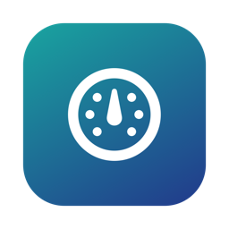
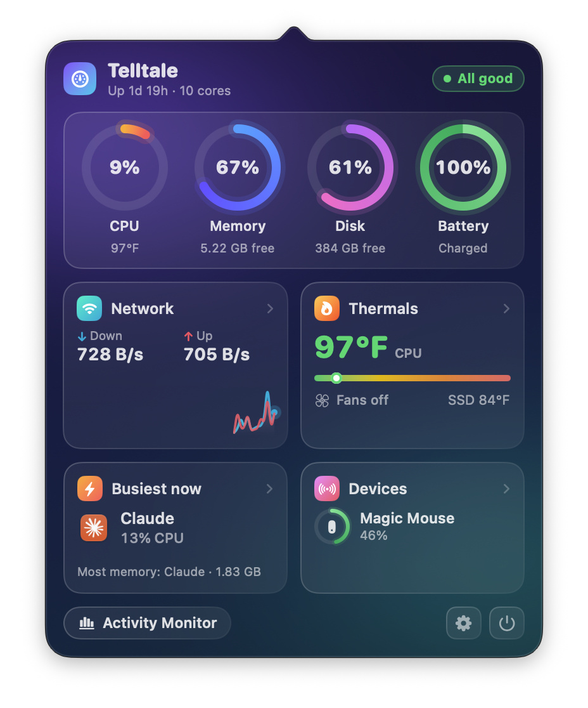
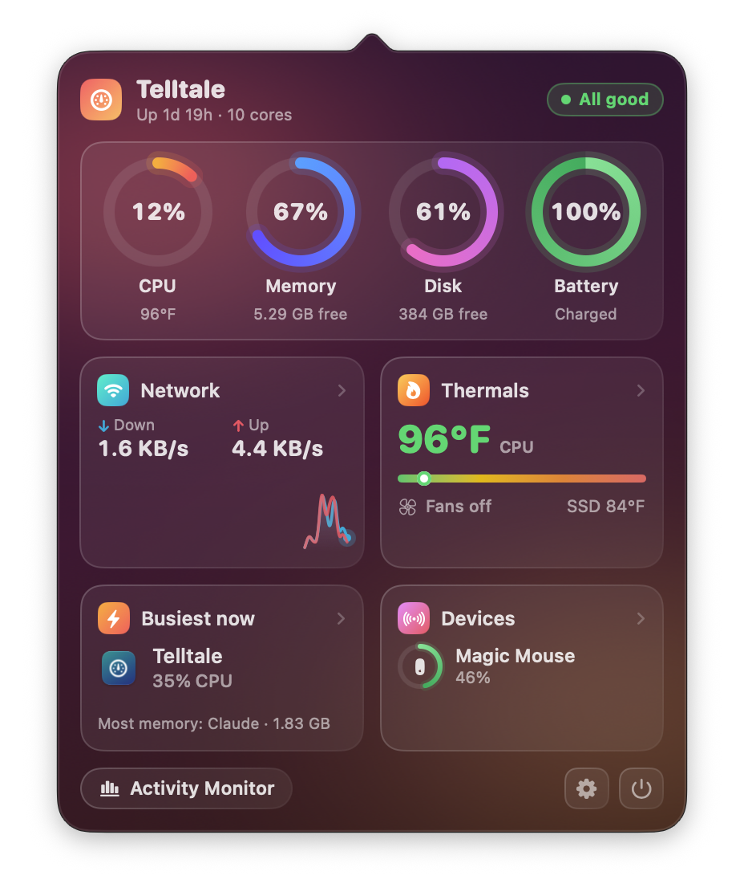
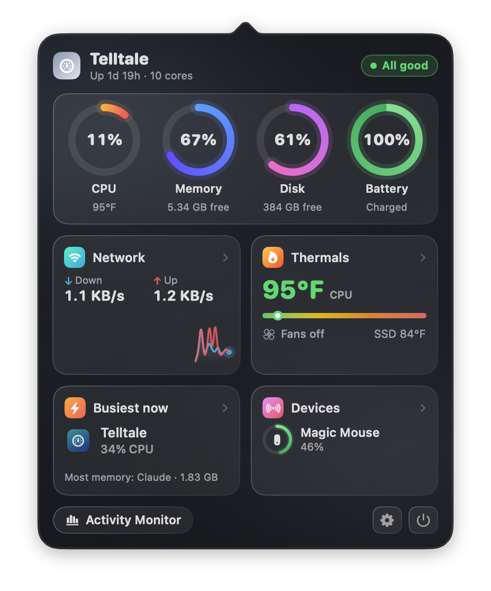
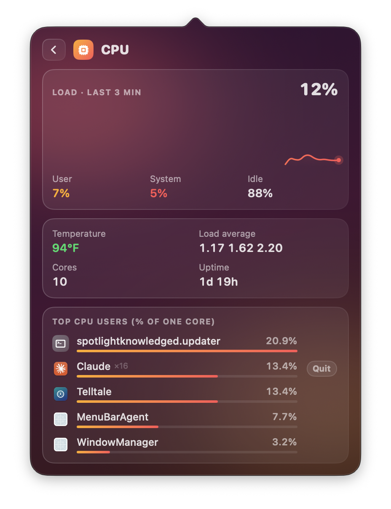
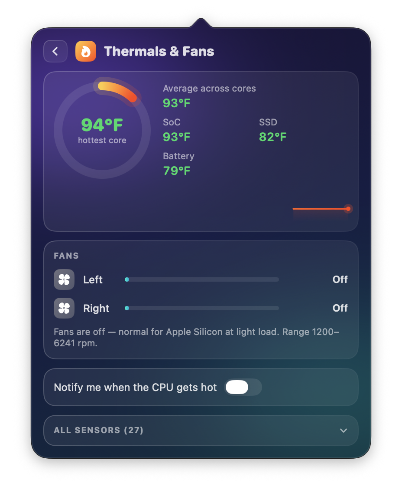
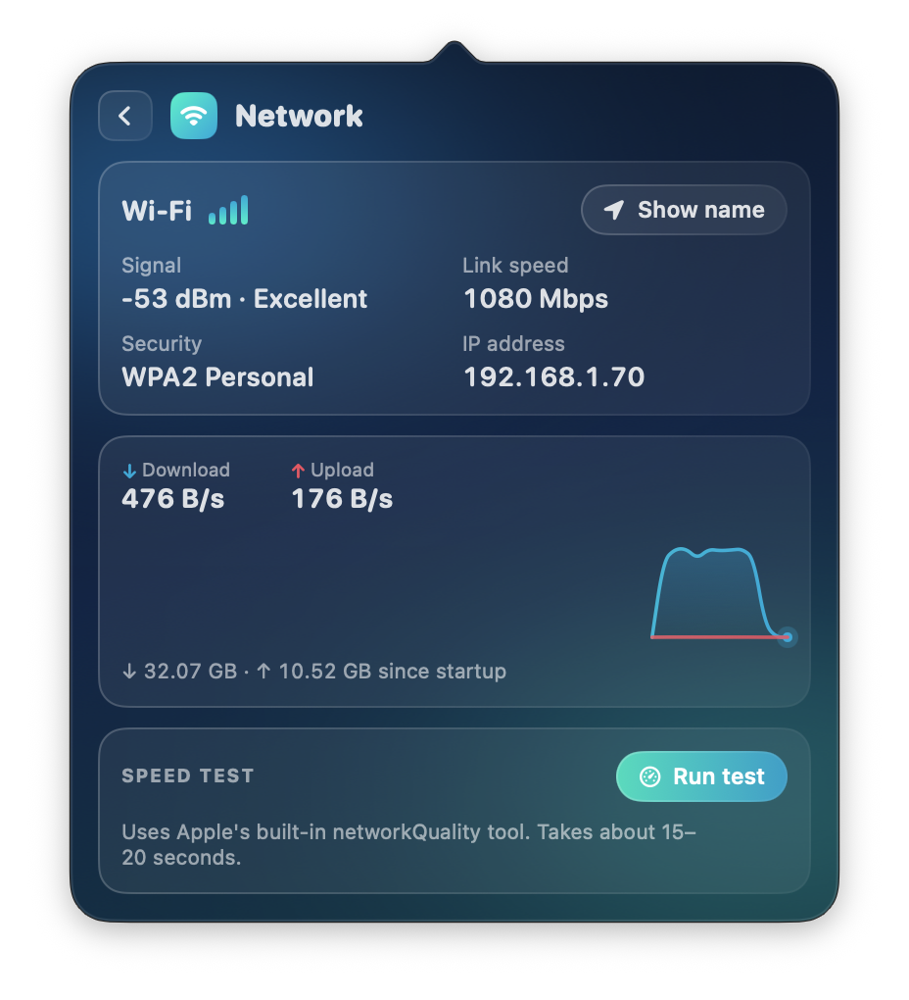
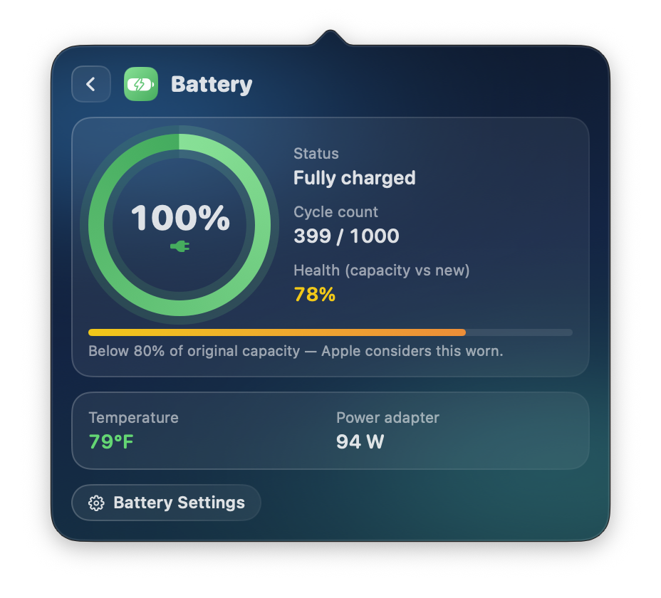
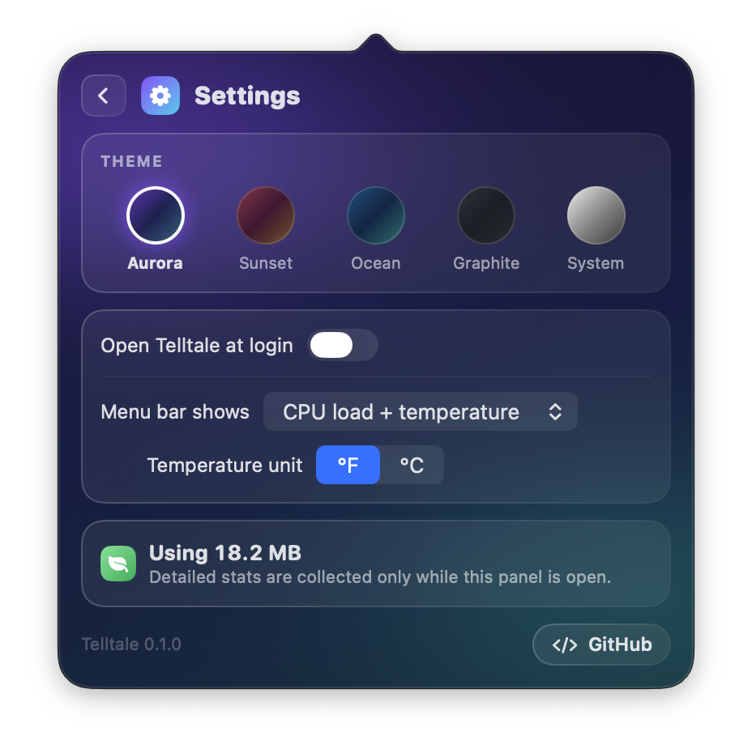

<div align="center">



# Telltale

**A beautiful, featherweight system monitor for your Mac's menu bar.**

CPU, memory, disk, battery, network, Bluetooth devices, temperatures and fans — one click away,
in a panel that idles at **~14 MB of memory and ~0% CPU**.

[](https://github.com/pri-te-sh/Telltale/actions/workflows/build.yml)
[](https://github.com/pri-te-sh/Telltale/releases/latest)


[](LICENSE)

[**Download**](https://github.com/pri-te-sh/Telltale/releases/latest) ·
[**Website**](https://pri-te-sh.github.io/Telltale/) ·
[Features](#features) · [Install](#install) · [FAQ](#faq) · [Contributing](#contributing)



</div>

---

> On a car dashboard, *telltales* are the little lights that tell you at a glance when something
> needs attention. Telltale does the same for your Mac.

## Why Telltale?

Most menu-bar monitors either look like spreadsheets or quietly cost hundreds of megabytes and a
steady trickle of CPU. Telltale is built to be both **pleasant to look at** and **almost free to run**:

| | Telltale | Typical all-in-one monitor |
|---|---|---|
| Memory while idle | **~14 MB** | 50–300 MB |
| CPU while idle | **~0%** (counters read every 3 s) | 1–4% |
| Background helpers / daemons | **None** | Often 1–3 |
| Network access | **None** (except the speed test you start) | Updates, analytics |
| Dependencies | **None** — one native Swift binary | Frameworks, Electron, helpers |

Numbers measured on an M1 Pro MacBook Pro with Activity Monitor's memory metric (`phys_footprint`).

## Features

<table>
<tr>
<td width="50%" valign="top">

**At a glance**
- Live gauges for **CPU**, **memory**, **disk** and **battery**
- **Health pill** that turns amber or red when something needs attention:
  *All good*, *Working hard*, *Memory tight*, *Battery low*, *Disk nearly full*, *Running hot*
- **Busiest app** right now, and the app using the most memory
- Optional live text in the menu bar: CPU %, memory %, CPU temperature

</td>
<td width="50%" valign="top">

**Thermals & fans**
- Hottest and average **CPU core** temperature, **SoC**, **SSD** and **battery** temperatures
- All raw sensors (27 on an M1 Pro) in one list
- **Fan speeds** for every fan, with min/max range
- **Overheating alerts** — a notification when the CPU stays above your threshold

</td>
</tr>
<tr>
<td valign="top">

**Memory & CPU**
- App / wired / compressed / cached memory, **pressure** and **swap**
- Load history graph, user / system / idle split, load average
- **Top apps** by memory and by CPU, with helper processes grouped under their app
  and a one-click **Quit**

</td>
<td valign="top">

**Battery, network & devices**
- Charge, status, time remaining, **cycle count**, **health vs. design capacity**,
  temperature and charger wattage
- Wi-Fi signal, link speed, security, IP, live up/down graphs, totals since startup
- **Speed test** using Apple's built-in `networkQuality`
- **Bluetooth accessories with battery** (Magic Mouse, Keyboard, Trackpad, AirPods…)
- **External drives** with free space and one-click eject

</td>
</tr>
</table>

**Themes** — Aurora, Sunset, Ocean, Graphite, or System (follows light/dark mode).

<p align="center">
  
  
  
</p>

<details>
<summary><b>More screenshots</b></summary>
<br>
<p align="center">
  
  
  
  
  
  
  
</p>
</details>

## Install

### Download (recommended)

1. Download **Telltale-x.y.z.zip** from the [latest release](https://github.com/pri-te-sh/Telltale/releases/latest).
2. Unzip it and drag **Telltale.app** to your **Applications** folder.
3. Open it — a gauge icon appears in your menu bar. Click it.

#### First launch

Telltale is open source and not (yet) notarized by Apple, so macOS will warn you the first time:

- **macOS 15 and later:** open Telltale once, then go to **System Settings → Privacy & Security**,
  scroll down and click **Open Anyway** next to the Telltale message.
- **macOS 14:** right-click **Telltale.app** → **Open** → **Open**.
- Or, from Terminal: `xattr -dr com.apple.quarantine /Applications/Telltale.app`

You only need to do this once. If you'd rather not trust a downloaded binary, [build it yourself](#build-from-source) — it takes about a minute.

### Build from source

Requirements: macOS 14 or later and Xcode (or the Xcode Command Line Tools: `xcode-select --install`).

```bash
git clone https://github.com/pri-te-sh/Telltale.git
cd Telltale
./build.sh --install
```

| Command | What it does |
|---|---|
| `./build.sh` | Build for this Mac → `build/Telltale.app` |
| `./build.sh --universal` | Build for Apple Silicon **and** Intel |
| `./build.sh --install` | Build, copy to `~/Applications` and launch |
| `./build.sh --zip` | Universal build packaged as `build/Telltale-<version>.zip` |

There is no Xcode project, package manager or third-party dependency — `build.sh` calls `swiftc` directly.

## Using Telltale

- **Click the menu bar icon** to open the panel. Click a gauge or card for details; **‹** goes back.
- **Settings** (⚙ at the bottom): theme, open at login, what the menu bar shows, °F / °C.
- **Menu bar text** options: icon only · CPU load · CPU + memory · CPU temperature · CPU + temperature.
- **Heat alerts:** Thermals & Fans → *Notify me when the CPU gets hot*, then pick a threshold.
- **Wi-Fi name:** macOS only reveals network names to apps with Location access. Click
  **Show name** on the Network page if you want it; Telltale never reads your location.

## Privacy & permissions

Telltale collects nothing and sends nothing. It has no analytics, no crash reporter and no update checker.

| Permission | When it's asked | Why |
|---|---|---|
| Location | Only if you click **Show name** | macOS hides Wi-Fi network names from apps without it |
| Notifications | Only if you turn on **heat alerts** | To show the overheating alert |
| Login items | Only if you turn on **Open at login** | To start with your Mac |

The only network traffic Telltale ever creates is Apple's `networkQuality` test, and only when you press **Run test**.

## How it works

Telltale reads everything directly from macOS — no kernel extensions, no root helper, no scraping of other tools.

| Data | Source |
|---|---|
| CPU load | `host_statistics` (`HOST_CPU_LOAD_INFO`) |
| Memory, pressure, swap | `host_statistics64` (`HOST_VM_INFO64`), `kern.memorystatus_level`, `vm.swapusage` |
| Per-app CPU & memory | `libproc` (`proc_pid_rusage` → `ri_phys_footprint`, CPU time), grouped by `.app` bundle |
| Disk | `URLResourceValues` (`volumeAvailableCapacityForImportantUsage` = Finder's "available") |
| Network throughput | `sysctl` ifmib 64-bit interface counters (same as `netstat`) |
| Wi-Fi | CoreWLAN |
| Battery | IOKit power sources + `AppleSmartBattery` registry (cycles, capacity, adapter) |
| Temperatures | IOHID temperature sensors (Apple Silicon PMU, SSD, battery gas gauge) |
| Fans | SMC keys `FNum`, `F#Ac`, `F#Mn`, `F#Mx` (read-only) |
| Bluetooth batteries | `system_profiler SPBluetoothDataType` + IOKit HID `BatteryPercent` |
| Speed test | `/usr/bin/networkQuality -c` |

### Why it stays light

- **The panel only exists while it's open.** The whole SwiftUI view tree is created when you click
  the icon and released when the panel closes.
- **Closed, it does almost nothing:** CPU, memory and network counters every 3 seconds (plus CPU
  temperature if you show it in the menu bar or turned on alerts). Process lists, sensors, battery,
  Wi-Fi and Bluetooth are read only while the panel is visible.
- **No per-frame work.** Gauges sweep in once when the panel opens; after that, live values update in
  place instead of animating every second (continuous animation would redraw 120× per second on
  ProMotion displays). Rolling digits are reserved for slow-changing values.
- **Expensive pixels are drawn once.** The themed backdrop with its blurred glows is rendered to a
  bitmap per theme, and app icons are flattened to small bitmaps.
- **Syscalls over subprocesses.** Only Bluetooth names (every 30 s while open) and the speed test spawn a process.

## FAQ

**Can Telltale control fan speeds?**
Not today. Reading fans is safe and needs no special rights; *setting* them requires a privileged
root helper and can overheat a Mac if done wrong. It may come later as an opt-in.

**Why isn't my iPhone's battery shown?**
macOS doesn't expose iPhone battery levels to third-party apps. Bluetooth accessories are supported.

**Does it work on Intel Macs?**
Release builds are universal. CPU, memory, disk, battery, network and devices work everywhere;
temperatures use Apple Silicon sensors, so on Intel some temperature readings may show "—". Intel
reports are welcome.

**Why not the Mac App Store?**
App Store apps are sandboxed and can't read thermal sensors, fan speeds or other apps' resource usage.

**The CPU temperature differs from another app.**
Telltale shows the hottest CPU die sensor (and the average on the Thermals page). Other apps may
average different sensors, so a few degrees of difference is normal.

**How do I uninstall it?**
Quit Telltale (⏻ in the panel), delete `Telltale.app`, and optionally remove its settings:
`defaults delete io.github.pri-te-sh.telltale`.

## Troubleshooting

| Problem | Fix |
|---|---|
| "Telltale can't be opened" / "unidentified developer" | See [First launch](#first-launch) |
| Wi-Fi shows "Wi-Fi" instead of its name | Click **Show name** and allow Location access |
| Heat alerts don't appear | System Settings → Notifications → Telltale → Allow |
| "Open at login" doesn't stick | System Settings → General → Login Items → enable Telltale |
| Something looks wrong | Run `Telltale.app/Contents/MacOS/Telltale --selftest` and attach the output to an issue |

## Project layout

```
Sources/
  main.swift          App entry, menu bar item, popover lifecycle
  Monitor.swift       Sampling schedule, state, actions (quit app, eject, speed test, alerts)
  SystemStats.swift   CPU, memory, disk, battery, network, Wi-Fi readers + temperature sensors
  SMC.swift           Read-only SMC access for fans
  Processes.swift     Per-app CPU and memory via libproc
  Theme.swift         Themes, glass surfaces, icon badges, cached backdrop
  Components.swift    Gauges, sparklines, meters, buttons, process list
  Views.swift         Overview and detail pages, settings
  Thermals.swift      Thermals & fans page
Resources/            Info.plist, app icon
scripts/              Screenshot tooling for docs
docs/                 GitHub Pages site
```

Developer flags: `--selftest` prints one set of readings and exits; `--open`, `--open-after=<sec>` and
`--panel=<memory|cpu|storage|battery|network|devices|thermals|settings>` open the panel for testing.

## Roadmap

- [ ] Developer ID signing and notarization
- [ ] Homebrew cask
- [ ] Per-core CPU view and GPU usage
- [ ] Optional fan control (privileged helper, opt-in)
- [ ] Configurable heat alerts for battery and SSD
- [ ] Localization

Ideas and pull requests are welcome — see below.

## Contributing

Bug reports, feature ideas and pull requests are very welcome. Please read [CONTRIBUTING.md](CONTRIBUTING.md) first.
The short version: keep it dependency-free, keep idle cost near zero, and measure before and after.

## Acknowledgements

Inspired by the menu-bar monitors that came before it, including
[Stats](https://github.com/exelban/stats), iStat Menus and CleanMyMac's menu. Telltale is an
independent project and is not affiliated with any of them.

## License

[MIT](LICENSE) © 2026 Pritesh Bhavsar
